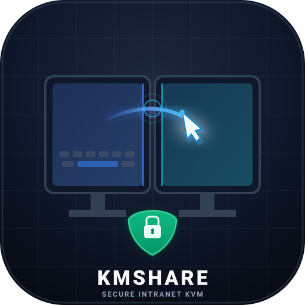
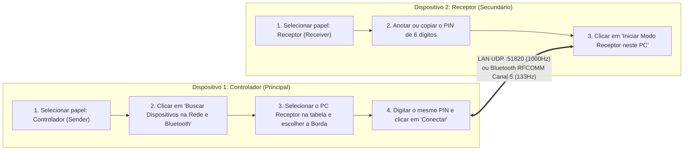
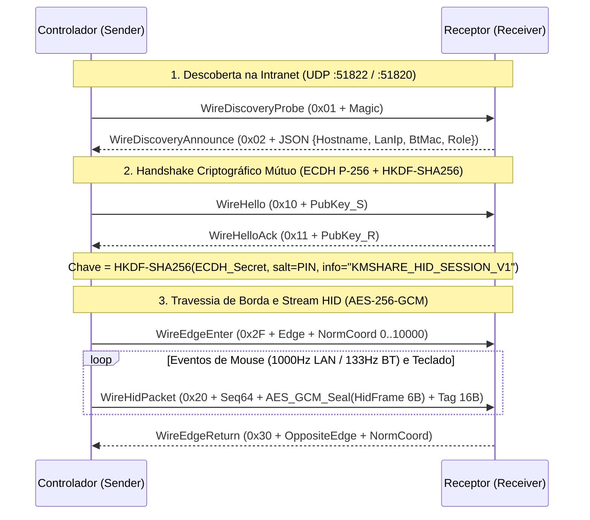

<p align="center">
  
</p>
<h1 align="center">KMShare</h1>
<p align="center">
  <b>Compartilhamento Seguro de Mouse, Teclado e Arquivos (100% Intranet &amp; User-Space)</b><br/>
  <i>Virtual KVM Multi-Edge Crossing &bull; Low-Latency Dual-Stack LAN / Bluetooth &bull; Zero External Dependencies</i>
</p>

<p align="center">
  
  
  
  
  
  
</p>

---

O **KMShare** é uma solução multiplataforma (`win-x64`, `linux-x64`, `osx-arm64`) de baixa latência para compartilhamento de **Mouse, Teclado (KVM virtual por travessia de borda)** e **Transferência de Arquivos Criptografados** entre computadores, projetada especificamente para operar **100% em User-Space (`asInvoker` / sem privilégios de Administrador)** e com **resiliência nativa a VPNs corporativas com Kill-Switch**.

---

## Sumário

1. [Principais Diferenciais](#1-principais-diferenciais)
2. [Como Operar em Cada Dispositivo (Interface Gráfica)](#2-como-operar-em-cada-dispositivo-interface-gráfica)
3. [Modos de Conexão e Resiliência a VPN (Modos A, B e C)](#3-modos-de-conexão-e-resiliência-a-vpn-modos-a-b-e-c)
4. [Scanner Automático de Rede (UDP + ARP Camada 2 + Bluetooth)](#4-scanner-automático-de-rede-udp--arp-camada-2--bluetooth)
5. [Arquitetura de Segurança e Criptografia](#5-arquitetura-de-segurança-e-criptografia)
6. [Referência de Linha de Comando (CLI)](#6-referência-de-linha-de-comando-cli)
7. [Compilação, Autoteste e Empacotamento Single-File](#7-compilação-autoteste-e-empacotamento-single-file)
8. [Integração Contínua (CI/CD) e Política de Branches](#8-integração-contínua-cicd-e-política-de-branches)
9. [Estrutura do Projeto e Arquivos de Apoio para IA](#9-estrutura-do-projeto-e-arquivos-de-apoio-para-ia)

---

## 1. Principais Diferenciais

- **Execução 100% User-Space (`asInvoker`):** Não exige conta de Administrador (`root`/`sudo`) para capturar ou injetar eventos HID nem para registrar inicialização automática no login do usuário.
- **Isolamento Estrito de Intranet (`IntranetGuard`):** O binário principal bloqueia em nível de socket qualquer tentativa de comunicação com IPs públicos da Internet, permitindo exclusivamente faixas RFC1918 (`10.0.0.0/8`, `172.16.0.0/12`, `192.168.0.0/16`), Link-Local, ULA e Loopback.
- **Criptografia Ponta-a-Ponta Autenticada:** Pareamento mútuo via **ECDH P-256 + HKDF-SHA256** vinculado a um **PIN de 6 dígitos** e cifragem de pacotes com **AES-256-GCM** e contador monotônico de 64 bits anti-replay.
- **Kill-Switch Anti-Anomalia em Tempo Real:** Detecta e revoga instantaneamente sessões com payloads fora do formato binário HID de 6 bytes, rajadas sobre-humanas de digitação (proteção contra injeção estilo Rubber Ducky) ou atalhos de shell remoto (`Win+R`).
- **Watchdog de 2.5s e Tecla de Emergência `[F12]`:** Heartbeat bidirecional a cada `500ms`. Se a conexão cair por mais de `2.5s` ou se o usuário pressionar `[F12]`, o mouse e o teclado locais são destravados imediatamente.
- **Mapeamento Proporcional Multi-Borda (`0..10000`):** Suporta travessia fluida nas 4 bordas (`Left`, `Right`, `Top`, `Bottom`) entre monitores de resoluções diferentes (ex.: `1920x1080` para `2560x1440`).
- **Transferência de Arquivos com Step-Up Auth por Transação:** Canal TCP dedicado (`:51821`) que solicita aprovação explícita do usuário no SO para cada arquivo, grava em `.part` temporário e valida o hash **SHA-256** antes do commit final.
- **Internacionalização Completa (i18n):** Suporte nativo em tempo de execução a Português (`PT`), Inglês (`EN`) e Espanhol (`ES`), com detecção de idioma do SO e persistência em `config.json`.
- **Sistema de Temas Dinâmico (Claro, Escuro e Sistema):** Alternância instantânea entre Tema Claro (White/Slate), Escuro (Midnight Slate) e Sincronizado com o Sistema (detecção de `AppsUseLightTheme` e barra de título DWM nativa sem flicker).
- **Identidade Visual e Ícone Nativo:** Logotipo vetorial moderno SVG e ícone multi-resolução `.ico` embutido no PE do executável (`ApplicationIcon`) e na área de notificações/bandeja.

---

## 2. Como Operar em Cada Dispositivo (Interface Gráfica)

Ao executar `KMShare.exe` (ou `dotnet run --project KMShare.csproj`), a **Central Gráfica de Conexão e Controle** é aberta automaticamente. Como cada computador exerce um papel na sessão, configure cada máquina conforme abaixo:



### Passo 1 — No Computador que será Controlado (Dispositivo Receptor / Secundário)
1. Abra o **KMShare**.
2. No cartão **1. Modo de Operação deste Dispositivo**, clique no botão **`Receptor (Secundário) — Receber Controle neste PC`**.
3. Verifique o **PIN de 6 dígitos** (ou clique em **`Copiar Meus Dados`** para copiar Hostname, IP LAN, MAC Bluetooth e PIN).
4. Clique no botão azul **`Iniciar Modo Receptor neste PC`**.
   - O computador passará a escutar simultaneamente em **Dual-Stack**:
     - **LAN Física UDP (`:51820`)** para controle em 1000Hz (Modos A e B);
     - **Bluetooth RFCOMM (Canal `5`)** para controle Out-of-Band (Modo C);
     - **Canal de Arquivos TCP (`:51821`)** com confirmação Step-Up;
     - **Beacon de Descoberta LAN (`:51822` / `:51820`)** para aparecer automaticamente na busca do outro PC.

### Passo 2 — No Computador Principal (Dispositivo Controlador / Sender)
1. Abra o **KMShare**.
2. No cartão **1. Modo de Operação deste Dispositivo**, mantenha selecionado **`Controlador (Principal) — Enviar Mouse e Teclado`**.
3. Informe o mesmo **PIN de 6 dígitos** exibido no computador receptor.
4. No cartão **2. Dispositivos na Rede Local e Bluetooth**, clique em **`Buscar Dispositivos na Rede e Bluetooth`** e clique sobre o computador receptor na tabela:
   - O **IP LAN Física**, o **MAC Bluetooth** e o **Modo de Operação Recomendado** são preenchidos automaticamente.
5. No cartão **3B. Borda do Monitor**, escolha em qual lado está posicionado o monitor do outro computador (`Esquerda`, `Topo`, `Base` ou `Direita`).
6. Clique em **`Conectar e Compartilhar Mouse / Teclado`**.
7. Mova o cursor até a borda escolhida para atravessar para o outro computador. Pressione **`[F12]`** a qualquer momento para retornar imediatamente o controle ao PC local.

---

## 3. Modos de Conexão e Resiliência a VPN (Modos A, B e C)

Em ambientes corporativos, clientes de VPN frequentemente ativam filtros WFP (*Kill-Switch*) que bloqueiam o tráfego IP local (Camada 3). O KMShare oferece três estratégias selecionáveis na interface:

| Modo | Transporte | Latência / Taxa | Requer Admin? | Quando Utilizar |
| :--- | :--- | :---: | :---: | :--- |
| **Modo A** | LAN Física Direta (`UDP :51820`) | `~0.8 ms` / `1000 Hz` | **Não (`asInvoker`)** | Rede local livre ou VPN com opção *"Allow LAN Traffic"* ativa. Faz bind explícito na placa física (ignora interfaces virtuais `tun`/`tap`/`wg`). |
| **Modo B** | LAN com Step-Up Auth (`/32` Rota + Firewall) | `~0.8 ms` / `1000 Hz` | **Pontual (Step-Up)** | Quando o scanner detecta o outro PC via **ARP Camada 2**, mas a VPN bloqueia a Camada 3. Cria rota `/32` e regra de firewall restrita ao IP único do peer. |
| **Modo C** | Bluetooth Out-of-Band (`RFCOMM Canal 5`) | `~7.5 ms` / `133 Hz` | **Não (`asInvoker`)** | Quando a VPN bloqueia toda a pilha TCP/IP e o usuário não possui ou não deseja usar elevação. Opera fora do WFP via Winsock `AF_BTH` / BlueZ `AF_BLUETOOTH` com `BluetoothMouseCoalescer`. |

---

## 4. Scanner Automático de Rede (UDP + ARP Camada 2 + Bluetooth)

O módulo [`NetworkPeerDiscovery`](src/Network/NetworkPeerDiscovery.cs) executa uma varredura híbrida em paralelo na sub-rede física `/24`:

1. **Beacon UDP KMShare (`:51822` e `:51820`):** Localiza instantaneamente qualquer instância aberta do KMShare na LAN, retornando o `Hostname`, `IP LAN`, `MAC Bluetooth`, `Papel Atual` e `Borda Configurada`.
2. **Sonda Camada 2 `SendARP` (`iphlpapi.dll`) + Ping ICMP:** Como pacotes ARP operam na Camada 2 (Enlace), o scanner descobre computadores fisicamente conectados na mesma rede **mesmo quando o Kill-Switch da VPN bloqueia 100% dos pacotes IP/UDP (Camada 3)**, recomendando automaticamente o **Modo B** ou **Modo C**.
3. **Enumeração Bluetooth User-Space (`bthprops.cpl` / BlueZ):** Lista todos os dispositivos Bluetooth pareados com seus respectivos endereços MAC para conexão imediata em **Modo C**.

---

## 5. Arquitetura de Segurança e Criptografia



---

## 6. Referência de Linha de Comando (CLI)

Além da interface gráfica padrão, todas as operações podem ser acionadas via terminal:

```powershell
# 0. Abrir a Interface Gráfica Nativa (comportamento padrão sem argumentos)
KMShare.exe --gui

# 1. Escanear a sub-rede LAN (UDP + ARP L2) e dispositivos Bluetooth via terminal
KMShare.exe --discover

# 2. Operar via Rede Local (Modos A / B)
KMShare.exe --listen 839201                        # No PC Receptor
KMShare.exe --connect 192.168.15.6 839201          # No PC Controlador

# 3. Operar via Bluetooth Out-of-Band (Modo C - Ignora VPN)
KMShare.exe --listen-bt 839201                     # No PC Receptor
KMShare.exe --connect-bt 00:D7:6D:52:B8:E9 839201  # No PC Controlador

# 4. Enviar arquivo criptografado com aprovação Step-Up por transação (:51821)
KMShare.exe --send-file 192.168.15.6 "C:\Caminho\Arquivo.pdf" 839201

# 5. Menu interativo em modo texto (TUI)
KMShare.exe --cli

# 6. Executar a suíte completa de verificação de segurança e integridade (10 Checks)
KMShare.exe --self-test
```

---

## 7. Compilação, Autoteste e Empacotamento Single-File

### Pré-requisitos
- **.NET 10.0 SDK** (`net10.0`) — zero dependências externas de pacotes NuGet.

### Compilação e Autoteste Rápido
```powershell
dotnet build KMShare.csproj
dotnet run --project KMShare.csproj -- --self-test
```

### Gerar Executáveis Single-File e Pacotes de Distribuição (`./dist/`)
```powershell
powershell -NoProfile -ExecutionPolicy Bypass -File .\build-all.ps1 -Version "1.0.0" -PackageAll -ScanDefender
```
O script gera compilações Single-File Self-Contained prontas para uso em todos os sistemas operacionais, empacota portables e instaladores, calcula hashes criptográficos e executa a varredura profunda do **Microsoft Defender Antivirus**:
- **Windows (`win-x64`)**:
  - `dist/KMShare-v1.0.0-win-x64-portable.zip` (Portable com `KMShare.exe` e `kmshare-updater.exe`)
  - `dist/KMShare-v1.0.0-win-x64-installer.exe` (Instalador Inno Setup no escopo `asInvoker` em `%LOCALAPPDATA%\Programs\KMShare`)
  - `dist/Install-KMShare.ps1` (Script instalador standalone User-Space)
- **Linux (`linux-x64`)**:
  - `dist/KMShare-v1.0.0-linux-x64-portable.tar.gz` (Portable com executáveis e lançador)
  - `dist/KMShare-v1.0.0-linux-x64.deb` (Pacote Debian com atalho `.desktop` e ícone)
  - `dist/KMShare-v1.0.0-linux-x64-installer.sh` (Instalador standalone User-Space para qualquer distro)
- **macOS (`osx-arm64` Apple Silicon)**:
  - `dist/KMShare-v1.0.0-osx-arm64-portable.tar.gz` (Portable com executáveis)
  - `dist/KMShare-v1.0.0-osx-arm64-app.zip` (Pacote `KMShare.app` com `Info.plist` pronto para `Applications`)
  - `dist/KMShare-v1.0.0-osx-arm64-installer.sh` (Script instalador de integração com o sistema)
- **Segurança e Integridade**:
  - `dist/CHECKSUMS.sha256` e `dist/CHECKSUMS.sha512`
  - Varredura profunda com **Microsoft Defender Antivirus** (`MpCmdRun.exe`)

---

## 8. Integração Contínua (CI/CD) e Política de Branches

O projeto adota o fluxo de segmentação **Gitflow** padronizado com o projeto **GitCommitMigrator**:

| Branch | Papel | Política de Pull Request e CI |
|---|---|---|
| `main` | Produção e Releases Oficiais | Aceita PRs **exclusivamente** de `develop`. Dispara o pipeline `release.yml` para compilação multiplataforma, empacotamento, scan Microsoft Defender e publicação da Release no GitHub. |
| `develop` | Integração Contínua e Desenvolvimento | Aceita PRs de branches de feature e correções (`feature/...`, `fix/...`). Dispara o pipeline `build-artifacts.yml` disponibilizando os binários mais recentes diretamente na aba de Actions do Git. |

- **Validador de Política de Branches (`ci.yml`)**: Bloqueia e fecha automaticamente qualquer Pull Request fora da hierarquia permitida (`develop -> main` ou `feature/fix -> develop`).
- **Autoteste de Segurança Obrigatório**: Todos os 10 testes de segurança, integridade de sockets, criptografia e isolamento intranet precisam passar com sucesso (`0 warnings`, `0 errors`) antes do merge.
- **Sincronização Automática (`sync-develop.yml`)**: Mantém a branch `develop` sempre atualizada com a `main` após cada release e impede a deleção acidental de `develop`.

---

## 9. Estrutura do Projeto e Arquivos de Apoio para IA

```text
KMShare/
├── LICENSE                                    # Licença MIT
├── README.md                                  # Documentação principal e guia de operação do projeto
├── AGENTS.md                                  # Guia de contexto, arquitetura e regras para agentes de IA
├── MAINTENANCE.md                             # Manual de sustentação, invariantes de SO e protocolos de rede
├── .agent/rules/kmshare.md                    # Regra ativa para assistentes de IA no workspace
├── .github/
│   ├── pull_request_template.md               # Template oficial de Pull Request
│   └── workflows/
│       ├── ci.yml                             # Política de branches, build e autoteste de segurança
│       ├── release.yml                        # Pipeline de release, empacotamento, Defender scan e publicação
│       ├── build-artifacts.yml                # Compilação contínua e publicação de artefatos na branch develop
│       └── sync-develop.yml                   # Proteção e sincronização automática de main para develop
├── packaging/
│   ├── windows/                               # Script Inno Setup (KMShare.iss) e instalador PowerShell
│   ├── linux/                                 # Lançador .desktop, empacotador Debian (.deb) e instalador .sh
│   └── macos/                                 # Info.plist, App Bundle builder e instalador macOS .sh
├── app.manifest                               # Manifesto User-Space (asInvoker, Common-Controls v6)
├── build-all.ps1                              # Script mestre de publicação e empacotamento multiplataforma
├── KMShare.csproj                             # Projeto principal (.NET 10, zero pacotes externos)
├── Program.cs                                 # Entrypoint GUI / CLI + Suíte de Verificação (--self-test)
├── src/
│   ├── Security/
│   │   ├── IntranetGuard.cs                   # Firewall de socket Intranet-Only (RFC1918/Link-Local/ULA/Loopback)
│   │   ├── SecureHidSession.cs                # ECDH P-256 + HKDF-SHA256 + AES-256-GCM + Kill-Switch + TrustedPeerVault
│   │   └── FileTransferGatekeeper.cs          # Step-Up Auth nativo do SO + Token HMAC de uso único (48 bytes)
│   ├── Network/
│   │   ├── KMSharePeerNode.cs                 # Nó Dual-Stack (LAN UDP :51820 + Bluetooth + Receptor de Arquivos :51821)
│   │   ├── NetworkPeerDiscovery.cs            # Scanner híbrido (Beacon UDP :51822/:51820 + SendARP /24 + Bluetooth)
│   │   ├── BluetoothRfcommNode.cs             # Transporte Out-of-Band RFCOMM (Win AF_BTH=32 / Linux BlueZ=31)
│   │   ├── VpnFallbackModes.cs                # Orquestrador Modos A/B/C + BluetoothMouseCoalescer (1000Hz -> 133Hz)
│   │   └── VpnKillSwitchProbe.cs              # Diagnóstico profundo Camada 2 (SendARP) vs Camada 3 (ICMP/mDNS/LLMNR/NetBIOS)
│   ├── Platform/
│   │   ├── IHidPlatform.cs                    # Abstração multiplataforma + EdgeCoordinateMapper (escala 0..10000)
│   │   ├── WindowsHidEngine.cs                # Win32 WH_MOUSE_LL/WH_KEYBOARD_LL + Watchdog 2.5s + Fallback UIPI
│   │   ├── LinuxHidEngine.cs                  # X11 (libX11/libXtst) + Wayland (xdg-desktop-portal / libei)
│   │   └── MacHidEngine.cs                    # macOS CoreGraphics CGEventTap (kCGSessionEventTap)
│   ├── FileTransfer/
│   │   └── SecureFileChannel.cs               # Canal TCP criptografado (:51821) em 3 etapas com .part e SHA-256
│   └── UI/
│       ├── KMShareGuiWindow.cs                # Interface Gráfica Nativa responsiva (Owner-Draw Fluent Cards & Controls)
│       └── TrayAndEdgeManager.cs              # Persistência de configuração, Autostart User-Space e TUI
└── updater/
    └── KMShare.Updater/
        ├── KMShare.Updater.csproj             # Binário isolado para atualização segura via HTTPS
        └── Program.cs                         # Verificador criptográfico Ed25519 (RFC 8032) + RSA-PSS + SHA-256
```

